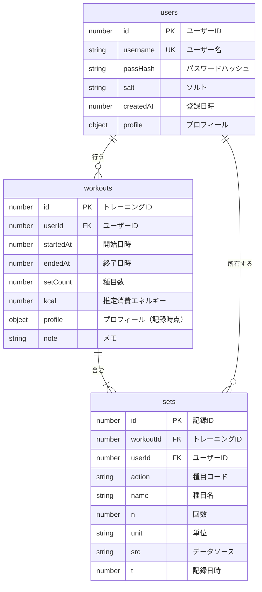

# ER 図

| 項目 | 内容 |
|---|---|
| システム名 | FIT CAPSULE 体験デモシステム（HAL224） |
| データベース | IndexedDB（DB 名 `fitcapsule`、スキーマバージョン 1） |
| アクセスライブラリ | Dexie.js 4.4.7 |
| 作成日 | 2026-11-19 |
| 関連資料 | データ辞書（`データ辞書.md`）、データベース設計書（`データベース設計書.md`） |

## 1. ER 図

表記：IE 記法（鳥の足記法）。各属性の右側は論理名。PK = 主キー、FK = 外部キー、UK = ユニークキー。

## 2. エンティティ一覧

| No | 論理名 | 物理名 | 概要 |
|---|---|---|---|
| 1 | ユーザー | `users` | この端末のブラウザに登録されたアカウント。パスワードはハッシュ化して保存する |
| 2 | トレーニング | `workouts` | ユーザーが 1 回の訪問（ページを開いてから閉じるまで）で行ったトレーニング |
| 3 | 種目記録 | `sets` | 1 回のトレーニングの中で行った種目ごとの回数 |

## 3. リレーションシップ一覧

| No | 親エンティティ | 子エンティティ | カーディナリティ | 結合キー | 説明 |
|---|---|---|---|---|---|
| 1 | ユーザー | トレーニング | 1 対 0..多 | `users.id` = `workouts.userId` | 1 人のユーザーは 0 回以上のトレーニングを行う。各トレーニングは必ず 1 人のユーザーに属する |
| 2 | トレーニング | 種目記録 | 1 対 1..多 | `workouts.id` = `sets.workoutId` | トレーニングは最初の種目を記録するときに作成されるため、種目記録を必ず 1 件以上含む |
| 3 | ユーザー | 種目記録 | 1 対 0..多 | `users.id` = `sets.userId` | ユーザー別の累計を、トレーニングを経由せずに集計するための冗長な関連。値は所属トレーニングの `userId` と常に一致する |

## 4. 参照整合性

IndexedDB には外部キー制約の機能がないため、アプリケーション側（`stickman-preview/src/db/history.js`）で次のように整合性を保つ。

| 操作 | ルール |
|---|---|
| 種目記録の登録 | トレーニングが存在し、その `userId` がログイン中のユーザーと一致する場合だけ登録する（一致しなければトランザクションごと取り消す） |
| トレーニングの削除 | 同じトランザクションで、そのトレーニングの種目記録もすべて削除する（カスケード削除） |
| 履歴の全削除 | ログイン中のユーザーの種目記録とトレーニングだけを、1 つのトランザクションで削除する |
| ユーザーの削除 | 機能として提供しない（展示用のため） |
