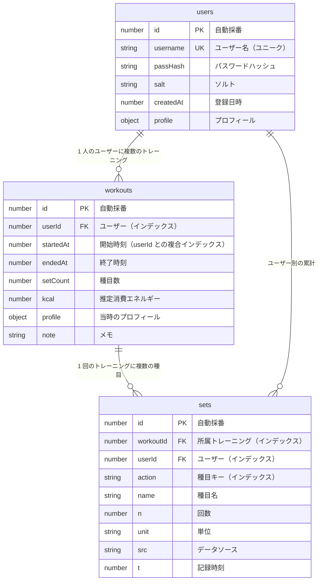
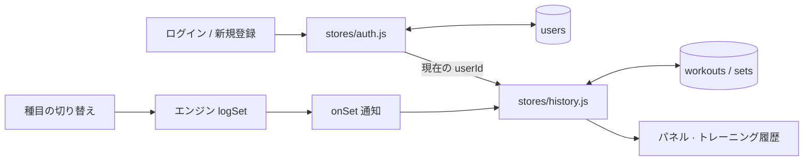

# データベース設計書（ユーザーとトレーニング履歴）

FIT CAPSULE 体験デモシステム · HAL224 · 2026-11-19

## 1. 概要

- ユーザーは新規登録、ログイン、ログアウトができる。
- ログイン中は、トレーニング記録（種目と回数）とプロフィール（体重・年齢・性別）がそのユーザーに紐づいて保存され、AI コーチの「記録管理」の基礎データになる。
- 各ユーザーが閲覧・編集・削除できるのは自分の記録だけである。
- 未ログインでも動作認識は通常どおり使えるが、トレーニング記録は保存されない。パネルには「ログインするとトレーニング記録を保存できます」と表示する。

## 2. 技術選定

| 項目 | 内容 |
|---|---|
| データベース | IndexedDB（ブラウザ内蔵の NoSQL データベース） |
| アクセスライブラリ | Dexie.js 4.4.7（IndexedDB のラッパー。テーブル定義・インデックス検索・トランザクションを担当） |
| パスワード処理 | Web Crypto API：PBKDF2-SHA256、ユーザーごとにランダムなソルト（16 バイト）、反復 100,000 回 |
| DB 名 | `fitcapsule`（スキーマバージョン 1） |

選定理由：
- 本システムは Vercel に配置したフロントエンドのみの展示用デモで、サーバーを持たない。IndexedDB はサーバーも追加費用も不要。
- アカウントと記録はこの端末のブラウザ内にだけ保存されるため、展示会場で複数の来場者が 1 台の端末を交代で使う場面に合っている。
- localStorage と違い、テーブル・ユニークインデックス・複合インデックス・トランザクションを持つため、増え続ける構造化データに向いている。
- 役割分担：
  - 設定のようなキー・バリュー（言語、表示の切り替えなど）と「いまログインしているのは誰か」（`stick.user`、ユーザー ID のみ）は localStorage に保存する。
  - アカウントとトレーニング記録は IndexedDB に保存する。

## 3. ER 図



## 4. テーブル定義

### 4.1 users（ユーザー）

| 項目 | 型 | 制約・インデックス | 説明 |
|---|---|---|---|
| id | number | PK、自動採番 | ユーザー ID |
| username | string | **ユニークインデックス**、1〜20 文字、前後の空白は除去 | ユーザー名 |
| passHash | string | 16 進 64 文字 | PBKDF2 で求めたパスワードハッシュ（**平文のパスワードは保存しない**） |
| salt | string | 16 進 32 文字 | ユーザーごとのランダム値 |
| createdAt | number | | 登録日時（エポックミリ秒） |
| profile | object | | プロフィール `{ w: 体重kg, age: 年齢, sex: 'm' \| 'f' }`。ログイン時に自動で読み込み、変更すると自動で保存 |

### 4.2 workouts（トレーニング）

ページを開いてから、ログイン中のユーザーが最初の種目を記録したときに 1 件作成する。途中でログインユーザーが替わった場合は、新しいユーザー用に別の 1 件を作成する。

| 項目 | 型 | 制約・インデックス | 説明 |
|---|---|---|---|
| id | number | PK、自動採番 | トレーニング ID |
| userId | number | FK → users.id、インデックス | 所属ユーザー |
| startedAt | number | 複合インデックス `[userId+startedAt]` | 開始時刻（エポックミリ秒） |
| endedAt | number | | 最後の種目の記録時刻 |
| setCount | number | 0 以上 | 記録した種目数 |
| kcal | number | 0 以上、整数 | 今回の推定消費エネルギー（kcal） |
| profile | object | | 当時のプロフィールのスナップショット（後でプロフィールを変えても、過去の記録は変わらない） |
| note | string | 最大 200 文字 | メモ（ユーザー入力） |

### 4.3 sets（種目の記録）

種目またはデータソースを切り替えるたびに、直前の種目を 1 件記録する。

| 項目 | 型 | 制約・インデックス | 説明 |
|---|---|---|---|
| id | number | PK、自動採番 | 記録 ID |
| workoutId | number | FK → workouts.id、インデックス | 所属トレーニング |
| userId | number | FK → users.id、インデックス | 所属ユーザー（冗長項目。累計を workouts を経由せずに集計するため） |
| action | string | インデックス | 種目キー（例：`squat`、`curl`、`jog`） |
| name | string | | 種目名（中国語の原文。表示時に翻訳） |
| n | number | 1 以上 | 回数または歩数 |
| unit | string | `次`（回）または `步`（歩） | 単位 |
| src | string | `演示`（デモ）または `摄像头`（カメラ） | データソース |
| t | number | | 記録時刻（エポックミリ秒） |

Dexie での定義（`stickman-preview/src/db/db.js`）：

```js
db.version(1).stores({
  users: '++id, &username',
  workouts: '++id, userId, [userId+startedAt]',
  sets: '++id, workoutId, userId, action'
});
```

## 5. 機能と CRUD

### 5.1 ユーザー（`src/db/users.js`、`src/stores/auth.js`）

画面：ヘッダー右側の「ログイン」ボタン。押すと「ログイン / 新規登録」の 2 つのタブを持つ画面が開く。ログイン後はユーザー名と「ログアウト」ボタンを表示する。

| 機能 | 関数 | 処理 |
|---|---|---|
| 新規登録 | `register` | ユーザー名とパスワードを検査 → ユニークインデックスで重複を確認 → ソルトとハッシュを生成 → users に追加 → 自動でログイン。新しいアカウントには、いま画面に出ているプロフィールを引き継ぐ |
| ログイン | `login` | ユーザー名で検索 → 保存済みのソルトでハッシュを計算し直して照合。ユーザー名が存在しない場合とパスワードが違う場合は**同じ**エラーを表示し、どのユーザー名が登録済みかを漏らさない |
| ログイン状態の維持 | `getUser` | ページを再読み込みしても、localStorage のユーザー ID でログイン状態を復元する |
| ログアウト | `logout` | ユーザー ID を消去し、プロフィールを未ログイン時の値に戻す |
| プロフィールの保存 | `saveProfile` | ログイン中に体重・年齢・性別を変えると、users.profile を自動で更新する |

### 5.2 トレーニング履歴（`src/db/history.js`、`src/stores/history.js`）

画面：右上の「パネル」→「トレーニング履歴」。すべての関数は `userId` を条件にする。

| 操作 | 画面 | 関数 | 処理 |
|---|---|---|---|
| 登録（Create） | 種目の切り替え時に自動 | `createWorkout` / `addSet` | sets に追加し、同じトランザクションで workouts の合計を更新。他人のトレーニングには追加できない |
| 参照（Read） | 履歴一覧、累計 | `listWorkouts` / `totalsByAction` | 複合インデックス `[userId+startedAt]` で新しい順に 20 件、workoutId インデックスで対応する sets を取得。userId インデックスで種目ごとに合計 |
| 更新（Update） | メモの編集 | `setNote` | そのユーザー自身の workouts.note だけを更新 |
| 削除（Delete） | 「削除」「すべて削除」（2 回押して確定） | `deleteWorkout` / `clearHistory` | 1 つのトランザクションでトレーニングとその sets を削除。「すべて削除」で消えるのはログイン中のユーザーの記録だけ |

## 6. データの流れ



- エンジン（`engine.js`）はデータベースにも、いまのユーザーが誰かにも依存せず、「1 種目を記録した」という通知を出すだけ。
- 未ログインのときは、store は何も書き込まない。

## 7. セキュリティ・例外処理・制約

- **パスワード**：ソルト付きの PBKDF2 ハッシュだけを保存し、平文は保存しない。2 人のパスワードが同じでも、ハッシュは異なる。
- **データの分離**：参照・更新・削除はすべて userId を条件にしており、他のユーザーの記録を読んだり消したりしない（単体テストで確認済み）。
- **IndexedDB が使えない場合**（シークレットモードなど）：パネルに一言表示し、動作認識などほかの機能は通常どおり動く。
- **書き込みの順序**：書き込みは順番に 1 件ずつ実行し、書きかけのデータが一覧に表示されないようにしている。
- **端末内のアカウント**：アカウントと記録は今使っている端末・ブラウザの中だけにあり、端末間では同期されない。展示会場の 1 台の端末で使うことを前提にした設計である。
- **書き込みのタイミング**：書き込むのは種目またはデータソースを切り替えたときだけなので、ページを閉じる直前に行っていた種目は記録されない。

## 8. テスト

`stickman-preview/test/history.test.js` で、fake-indexeddb（メモリ上の IndexedDB）を使って次の点を確認している。
- 登録時にハッシュだけが保存されること、ソルトがユーザーごとに異なること、重複したユーザー名や不正な入力が拒否されること、ログインのエラー表示が統一されていること、プロフィールがユーザーごとに保存されること。
- 合計の更新、並び順、種目ごとの累計、メモ、関連データの一括削除。
- 他のユーザーの記録を参照・更新・削除できないこと。
