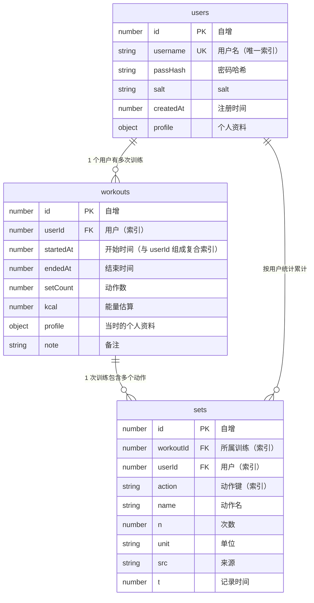
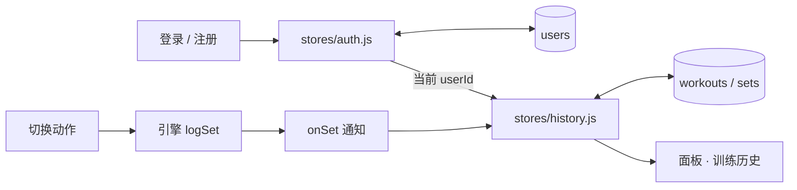

# 数据库设计书（用户与训练历史）

FIT CAPSULE 体验演示系统 · HAL224 · 2026-11-19

## 1. 概要

- 用户可以注册、登录、退出登录。
- 登录后，训练记录（动作和次数）和个人资料（体重、年龄、性别）保存在该用户名下，作为 AI 教练「記録管理」的基础数据。
- 每个用户只能查看、编辑、删除自己的记录。
- 未登录时，动作识别照常可用，但不保存训练记录，面板会提示"登录后可以保存训练记录"。

## 2. 选型

| 项目 | 内容 |
|---|---|
| 数据库 | IndexedDB（浏览器内置的 NoSQL 数据库） |
| 访问库 | Dexie.js 4.4.7（IndexedDB 的封装库，负责表定义、索引查询、事务） |
| 密码处理 | Web Crypto API：PBKDF2-SHA256，每个用户一个随机 salt（16 字节），迭代 100,000 次 |
| 库名 | `fitcapsule`（schema 版本 1） |

选型理由：
- 本系统是部署在 Vercel 上的纯前端展会演示，没有服务器。IndexedDB 不需要服务器，也不需要额外费用。
- 账户和记录只保存在这台设备的浏览器里，适合展会现场多位体验者轮流使用同一台终端的场景。
- 和 localStorage 不同，IndexedDB 支持表、唯一索引、复合索引和事务，适合会持续增加的结构化记录。
- 分工：
  - 设置类键值（语言、显示开关等）和"当前登录的是谁"（`stick.user`，只存用户 ID）保存在 localStorage；
  - 账户和训练记录保存在 IndexedDB。

## 3. ER 图



## 4. 表定义

### 4.1 users（用户）

| 字段 | 类型 | 约束 / 索引 | 说明 |
|---|---|---|---|
| id | number | PK，自增 | 用户 ID |
| username | string | **唯一索引**，1–20 字，去掉首尾空格 | 用户名 |
| passHash | string | 64 位十六进制 | PBKDF2 得到的密码哈希（**不保存明文密码**） |
| salt | string | 32 位十六进制 | 每个用户一个随机值 |
| createdAt | number | | 注册时间（epoch 毫秒） |
| profile | object | | 个人资料 `{ w: 体重kg, age: 年龄, sex: 'm' \| 'f' }`，登录后自动载入，修改后自动保存 |

### 4.2 workouts（训练）

每次打开页面后，登录用户记下第一个动作时创建一条。中途换了登录用户，就为新用户另建一条。

| 字段 | 类型 | 约束 / 索引 | 说明 |
|---|---|---|---|
| id | number | PK，自增 | 训练 ID |
| userId | number | FK → users.id，索引 | 所属用户 |
| startedAt | number | 复合索引 `[userId+startedAt]` | 开始时间（epoch 毫秒） |
| endedAt | number | | 最后一个动作的记录时间 |
| setCount | number | ≥ 0 | 记录的动作数 |
| kcal | number | ≥ 0，整数 | 本次的能量消耗估算（kcal） |
| profile | object | | 当时的个人资料快照（以后改了资料，旧记录也不受影响） |
| note | string | 最多 200 字 | 备注（用户输入） |

### 4.3 sets（动作记录）

每切换一次动作或来源，就为上一个动作记一条。

| 字段 | 类型 | 约束 / 索引 | 说明 |
|---|---|---|---|
| id | number | PK，自增 | 记录 ID |
| workoutId | number | FK → workouts.id，索引 | 所属训练 |
| userId | number | FK → users.id，索引 | 所属用户（冗余字段，统计累计时不用经过 workouts 表） |
| action | string | 索引 | 动作键（例：`squat`、`curl`、`jog`） |
| name | string | | 动作名（中文原文，显示时翻译） |
| n | number | ≥ 1 | 次数或步数 |
| unit | string | `次` 或 `步` | 单位 |
| src | string | `演示` 或 `摄像头` | 数据来源 |
| t | number | | 记录时间（epoch 毫秒） |

Dexie 中的定义（`stickman-preview/src/db/db.js`）：

```js
db.version(1).stores({
  users: '++id, &username',
  workouts: '++id, userId, [userId+startedAt]',
  sets: '++id, workoutId, userId, action'
});
```

## 5. 功能与 CRUD

### 5.1 用户（`src/db/users.js`、`src/stores/auth.js`）

界面：顶栏右侧的「登录」按钮，点开后有「登录 / 注册」两个标签页；登录后显示用户名和「退出」按钮。

| 功能 | 函数 | 处理 |
|---|---|---|
| 注册 | `register` | 检查用户名和密码 → 用唯一索引检查重名 → 生成 salt 和哈希 → 新增 users 记录 → 自动登录。新账户沿用当前屏幕上的个人资料 |
| 登录 | `login` | 按用户名查找 → 用保存的 salt 重新计算哈希并比对。用户名不存在和密码错误给出**同一条**错误提示，不泄露哪些用户名已注册 |
| 保持登录 | `getUser` | 刷新页面后，用 localStorage 中的用户 ID 恢复登录状态 |
| 退出登录 | `logout` | 清除用户 ID，个人资料恢复为未登录时的值 |
| 保存个人资料 | `saveProfile` | 登录状态下修改体重、年龄、性别时，自动更新 users.profile |

### 5.2 训练历史（`src/db/history.js`、`src/stores/history.js`）

界面：右上角「面板」→「训练历史」。所有函数都以 `userId` 作为条件。

| 操作 | 界面 | 函数 | 处理 |
|---|---|---|---|
| 增（Create） | 切换动作时自动执行 | `createWorkout` / `addSet` | 新增 sets 记录，并在同一个事务里更新 workouts 的合计；不能往别人的训练里加记录 |
| 查（Read） | 历史列表、累计 | `listWorkouts` / `totalsByAction` | 用复合索引 `[userId+startedAt]` 倒序取最近 20 次，用 workoutId 索引取对应的 sets；用 userId 索引按动作合计 |
| 改（Update） | 编辑备注 | `setNote` | 只更新这个用户自己的 workouts.note |
| 删（Delete） | 「删除」「全部删除」（按两次确认） | `deleteWorkout` / `clearHistory` | 在一个事务里删除训练及其 sets；「全部删除」只删除当前用户的记录 |

## 6. 数据流



- 引擎（`engine.js`）不依赖数据库，也不知道当前是哪个用户，只负责发出"记下了一个动作"的通知。
- 未登录时，store 不会写入任何数据。

## 7. 安全、异常处理与限制

- **密码**：只保存加了 salt 的 PBKDF2 哈希，不保存明文；即使两个用户的密码相同，哈希也不一样。
- **数据隔离**：所有查询、修改、删除都以 userId 作为条件，不会读取或删除其他用户的记录（有单元测试验证）。
- **无法使用 IndexedDB 时**（如无痕模式）：面板显示一句提示，动作识别等其他功能照常运行。
- **写入顺序**：写入按顺序依次执行，列表不会显示写到一半的数据。
- **本机账户**：账户和记录只在当前设备的当前浏览器里，不会在不同设备之间同步。这是面向展会单台终端的设计。
- **写入时机**：只在切换动作或来源时写入，所以关闭页面前正在做的那个动作不会被记录。

## 8. 测试

`stickman-preview/test/history.test.js` 在 fake-indexeddb（内存中的 IndexedDB）上验证：
- 注册时只保存哈希、salt 每人不同、重名和不合法输入被拒绝、登录错误提示统一、个人资料按用户保存；
- 训练合计更新、排序、按动作累计、备注、级联删除；
- 不能读取、修改、删除其他用户的记录。
